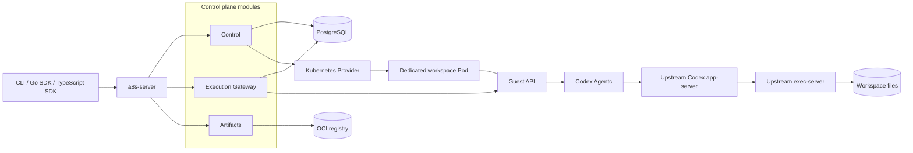

# Architecture

a8s owns Agent deployment state and workspace execution ownership. It delegates
native conversations and tool execution to a harness adapter and compute/storage
operations to a provider.

## Components

The diagram shows responsibility boundaries. These are packages, not a
requirement for a separate service per component. The current convenience
installer runs Control, Execution Gateway, and registry adapters in one API
server per Agent.

| Package | Responsibility |
| --- | --- |
| `api/` | Public Control protobuf contracts, errors, and scope identity |
| `artifacts/` | Package validation, OCI layout/registry access, digest verification |
| `control/` | Deployment desired state, Releases, Operations, and workspace ownership |
| `control/controllers/` | Lifecycle reconciliation and idle policy decisions |
| `execution/` | Idempotent input acceptance, original-target routing, results, interactions, live events |
| `agentc/contract/` | Harness-independent lifecycle/execution interfaces and transport |
| `agentc/codex/` | Native Codex protocol adapter, dispatch journal, and activity observations |
| `agentc/state/` | Rebuildable terminal-result cache |
| `guest/` | Workspace UID/lease, process supervision, activity census, park/wake |
| `providers/contract/`, `providers/kubernetes/` | Compute intent, Pod/Service operations, stop evidence, retained PVCs |
| `storage/` | PostgreSQL persistence and explicit schemas |
| `sdk/`, `sdk/ts/`, `cmd/a8s/` | Client APIs and command-line tooling |
| `cmd/a8s-server/`, `cmd/a8s-guest/` | Application-owned configuration and composition |

## Resource model

An **AgentDeployment** combines Agent content, a fixed runtime revision, and a
persistent workspace. Its **Release** records the resolved immutable artifacts.
An **Instance** is a concrete execution owner. An **Operation** records lifecycle
progress and external side effects.

An a8s **RuntimeClass** combines the harness adapter and sandbox/runtime image.
It is an application-level catalog concept, not Kubernetes'
`node.k8s.io/RuntimeClass`. The current built-in class is `codex-node`.

An execution **Binding** contains scope, Deployment, workspace, instance,
Release, and epoch. Requests follow the committed binding; health alone does not
authorize routing to another instance.

## Workspace topology

The current implementation assigns one workspace to a dedicated Pod. Multiple
native Threads are conversations within that workspace. They share files and
the native Codex state directory; they do not each receive a separate Pod.

The Pod contains:

- A root PID 1 Guest supervisor with a private container PID namespace.
- An unprivileged workspace worker and dedicated numeric UID.
- Agentc, Codex app-server, and exec-server running under that workspace identity.
- A PVC containing work files, native state, ownership records, and receipts.

The public Guest/Agentc control endpoint is normally port `8094`. Agentc's
private loopback endpoint is `8096`, and the exec-server is on loopback `8095`.
A manually assembled Guest can expose its public API on a different port.

The Guest checks identity with PID and kernel start ticks. Background processes
that create a new session or leave their original parent are still found by UID.
The filesystem lease and private ownership registry prevent the normal managed
path from admitting a second writer to an owned workspace.

This is process/UID isolation within the runtime topology. The implementation
does not claim hostile multi-tenant isolation, network policy enforcement, or
fencing of an unreachable node/storage writer.

## Creation and execution

1. The Agentfile build produces an Agent content image. The publisher also
   generates a verified metadata package.
2. The operator publishes a fixed runtime image; the author selects its class.
3. Control persists the create intent and immutable Release, then asks the
   Kubernetes provider to prepare the execution Pod against an existing PVC.
4. Guest preloads and verifies the fixed content image, then admits the prepared
   workspace binding and starts the unprivileged worker.
5. Agentc verifies the original Codex binary and native protocol readiness.
   Control commits the target and opens execution admission.
6. Gateway records a caller-keyed input before forwarding it to the bound
   instance. Agentc keeps a separate native dispatch journal.

PostgreSQL is authoritative for platform resources and accepted request records.
Codex is authoritative for native Thread/Turn history. The result cache is a
local derivative that can be rebuilt from native history.

## Reclamation versus replacement

[Idle reclamation](idle-reclamation.md) is an in-place transition of the same
Instance: it retains the Pod, storage lease, immutable binding, epoch, native
history, and dispatch receipts. New input restarts processes against that same
state.

Replacement, rollback, and offline handoff require closing admission, draining
all work, proving native persistence and old-writer release, preparing the new
owner, and committing ownership. Their state machines exist, but the general
Codex handoff proof is not yet complete. The convenience workflow therefore
keeps those operations guarded.

A missing Pod, timeout, or cancelled client wait is never proof that a command
did not execute or that storage has no writer. Unknown outcomes retain their
original operation/request identity and block automatic redispatch.
