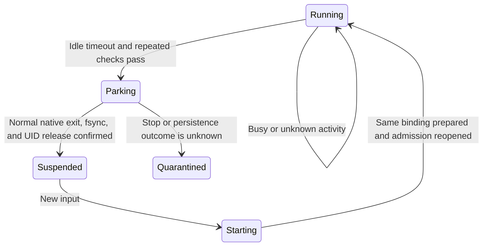

# Idle runtime reclamation

Idle reclamation reduces actual process memory while keeping a workspace ready
to accept input on the same backend. It currently applies to `AgentDeployment`.
It is not Pod deletion, checkpointing, or a transfer to another instance.

## Configuration

```yaml
idleReclaim:
  enabled: true
  idleTimeout: 10m
  checkInterval: 1m
```

The default is disabled. Positive durations are required. The management script
validates the YAML; Control validates and persists the policy in the Deployment
specification/Release. The provider passes that authoritative policy into the
Guest launch configuration.

The idle controller belongs to `control/controllers`. The Guest application
composes it into the supervisor process, so there is no additional always-on
controller service per workspace. The initial polling phase is randomized.
Polling is conservative: work becoming idle, observation failures, and timer
alignment can delay reclamation beyond `idleTimeout`.

## What keeps a runtime active

Agentc observes native loaded Threads, active Turns, queued inputs, pending
interactions, background terminals, and incomplete goals. It also tracks
in-flight mutations and unresolved dispatch intents.

Guest adds a census of every process carrying the workspace UID. Sleeping
processes and detached/background children remain work. Low CPU consumption is
not evidence of idleness. Only observed framework processes with matching PID
and start ticks are excluded from the business-process count.

Reclamation is prevented by:

- Any native work, background OS process, or unresolved request outcome.
- An observation error or an inventory whose completeness is unknown.
- A newly opened Thread that has not received its first persisted input.
- Persistent MCP server processes, which are conservatively treated as work.

The empty-Thread rule preserves its native identity: that Thread may not yet
have resumable native history. Its first accepted input removes this barrier.
An abandoned empty Thread can therefore retain the runtime.

The frontend example includes a persistent MCP server. Its presence can prevent
automatic reclamation even after the visible conversation finishes. Use an
Agent without persistent MCP processes to exercise the full idle path.

## Park and wake



The idle controller serializes new mutations against parking. Guest freezes
new execution entries, cancels passive subscriptions, waits for admitted RPCs,
and repeats the native/process checks.

Agentc closes app-server stdin and requires a normal native exit. It explicitly
syncs native state. Guest then gracefully stops the observed framework processes
and verifies that no process remains under the workspace UID. This automatic
path does not escalate to SIGKILL. A failed proof quarantines the slot and
retains its lease instead of handing it to another owner.

`Suspended` means runtime processes have stopped. The Guest and Pod remain
running, and Kubernetes readiness remains available. Files, native history,
receipts, cached results, the binding, and its epoch remain unchanged.

A new mutation starts the worker and original Codex binary again and prepares
the same binding/runtime directory. Native Thread history is resumed as needed.
An interrupted start or uncertain previous exit does not authorize a fresh owner.

## Polling and subscriptions

Completed input results are cached beside the native state. Result polling can
continue while suspended without restarting Codex. A result absent from that
cache may require one native wake-up to read history and populate the cache.

Ordinary polling does not renew the idle deadline. Passive event subscriptions
are released during parking and must reconnect as appropriate. They do not
represent background business work and do not keep the runtime alive.

The authenticated Guest status endpoint is `GET /v1/status`. It exposes the slot
phase, activity counts/reason, observation time/error, startup duration, history
flush evidence, and process-release evidence. Platform Control still retains the
logical execution binding while the slot is sleeping.

## Cost and limits

Observations use native read-only RPCs and `/proc`; they do not call the model.
Cost grows with loaded Threads and processes. A one-minute interval is the
normal example configuration. Native-history synchronization is performed when
parking, not on every periodic check.

Reclamation reduces actual process memory. It does not resize Pod requests or
limits, release the PVC, shrink a node pool, or replenish a generic Pod pool.
The current implementation does not move sleeping workspaces to another Pod.

See [project status](project-status.md) for the recorded manual validation and
its environment-specific timings.
