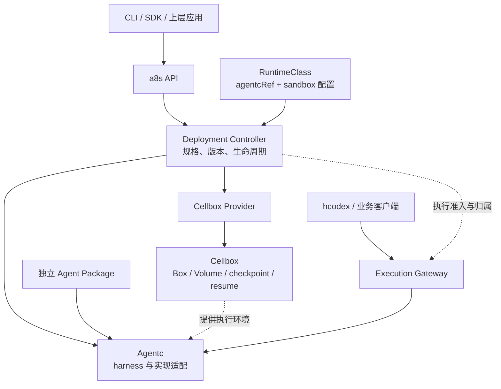

# a8s 架构设计

状态：目标架构初稿，2026-11-09。术语和职责以本轮讨论确认的边界为准，本文不表示新仓库已实现相应能力。

## 1. 定位与目标

a8s 管理 Agent 能力制品、执行器、运行环境组合，以及它们的部署生命周期。上层通过稳定接口使用 Agent，运行组件和环境可以独立演进。

重构目标是让每个概念有明确含义、每类状态有唯一管理者、每种变更有可预测的影响范围。现有功能作为迁移基础，逐步收敛职责。

| 层次 | 负责的内容 |
| --- | --- |
| Colony / 业务应用 | 数字员工产品、组织关系、业务授权、渠道和业务工具接入 |
| hcodex | 多人会话、参与者、输入作者、多人发送规则 |
| a8s | Agent 组件、运行组合、部署生命周期、执行入口与归属 |
| Cellbox | Box、Volume、隔离环境、checkpoint、快速 resume |
| Kubernetes | 节点资源、Pod 调度及基础设施运行 |

a8s 不建设自己的 Node、Scheduler、kubelet、CNI 或 CSI。具体业务审批规则、记忆系统、模型代理和渠道均作为外部能力接入；核心只保留必要的交互和配置契约。

## 2. 核心对象

### Agent Package

Agent Package 是独立能力制品，包含指令文件、Skills、CLI、辅助资源及能力元数据。讨论中的 `agent.md` 与现有工程中的 `AGENTS.md` 表达指令入口，具体包布局另行定义。

- 独立构建、发布和固定版本，可使用 OCI artifact 分发。
- 不引用具体 Sandbox Image、Box、节点或业务凭证。
- 可以声明 Python、Node、工具协议等必要能力要求，部署时检查兼容性。
- 不因为更换 Sandbox Image 就重新构建；同一份制品可以部署到不同的兼容环境。

Agent Package 不是 Sandbox 镜像的一层，也不与 Sandbox Image 共用一套版本生命周期。包内 CLI 的平台和依赖要求仍需满足，解耦不表示任意组合都可以运行。

### Agentc

Agentc 是加载并运行 Agent 的执行器。可以基于 Codex app-server、Claude Code、DeepSeek harness 等构建实现，通过适配满足 Agentc 契约；本文不宣称它们已经接入 a8s。

- Agentc 独立构建、分发和版本化。
- 接收准备好的 Agent Package 与运行配置，提供执行、交互、状态报告和停止等能力。
- 具体实现可以包含 harness、协议适配、配置渲染、宿主启动、原生存储和恢复扩展。
- Agentc 是执行器这一完整边界；不是仅负责启动子进程的通用工具，也不要求在 harness 上再实现一套 agent loop。
- 核心通过版本化接口使用 Agentc；具体实现可以声明可选能力，未支持的能力应明确返回不支持。

Agentc 的独立性指公共契约、构建产物与发布版本独立，不强制每种实现分别建立仓库或共享服务。底层沙箱创建、镜像构建、平台发布策略由其他模块负责。

### RuntimeClass

a8s RuntimeClass 表达一套可复用的 Agent 运行环境组合：

```text
RuntimeClass revision
├── agentcRef：固定 Agentc 版本
├── sandbox
│   ├── provider：当前为 Cellbox
│   ├── image：固定 Sandbox Image
│   └── 环境默认配置与约束
└── 公共运行配置和兼容性声明
```

Sandbox Image 提供 Linux、Python、Node、系统库等基础环境。Agentc 通过独立制品准备，不要求修改基础环境镜像才能发布执行器版本。

Sandbox 配置当前内嵌于 RuntimeClass。a8s 不新增独立 Sandbox / SandboxTemplate 顶层资源；实际 Box、模板、revision 和 Volume 仍由 Cellbox 管理。Cellbox 适配器将运行环境要求转换为其支持的对象引用，并记录解析后的具体 revision。

RuntimeClass 的可读名称可以保持稳定，每次改变组合生成不可变 revision。Deployment 固定引用 revision，修改名称对应的默认版本不会静默更新现有部署。

RuntimeClass 保存可复用的环境默认值与约束；Deployment 保存具体工作区、凭证引用及允许范围内的资源覆盖。公共环境配置中不嵌入某个员工的业务身份或秘密值。

### Deployment

Deployment 是稳定的逻辑工作负载，绑定：

1. 一个固定的 Agent Package 版本；
2. 一个固定的 RuntimeClass revision；
3. 一个 Workspace，以及运行配置和生命周期策略。

创建、上线、更新、回滚和下线都操作 Deployment。Agent Package 本身不是运行实例，发布制品到仓库也不等于更新现有 Deployment。

每次部署变更生成可追溯的完整规格快照，至少记录 package、Agentc、Sandbox Image、RuntimeClass revision 和相关配置版本。原始配置引用与解析结果一并保留，以支持诊断和回滚。

下列 YAML 仅说明组合关系，字段尚未形成公共 API：

```yaml
# RuntimeClass 的一个不可变版本
name: codex-python
revision: rc-1
agentcRef: codex@<agentc-digest>
sandbox:
  provider: cellbox
  image: registry.example/environments/python-node@<image-digest>

---
# Deployment
name: analyst
agentRef: registry.example/agents/data-analyst@<package-digest>
runtimeClassRef: codex-python@rc-1
workspaceRef: analyst-workspace
desiredState: online
updatePolicy: drain-and-restart
```

### Workspace、Instance、Thread 和 Turn

| 对象 | 含义与边界 |
| --- | --- |
| Workspace | 持久工作环境的逻辑身份与存储引用。文件数据由 Cellbox Volume 或选定存储后端持有，不绑定能力包版本 |
| Instance | 某个 Deployment 当前的一次实际运行组合，记录具体版本、Agentc 连接和 Box 引用；初期作为部署的内部运行状态管理 |
| Thread | Agentc/harness 管理的持续执行上下文，通过平台执行入口访问 |
| Turn | Thread 中的一轮执行，关联输入、工具、审批交互和结果 |

首版采用一个 Deployment 绑定一个 Workspace 的简单模型。实例替换保持 Workspace 身份；同一可写 Workspace 的执行归属需要唯一。更复杂的工作区数量和共享策略由明确需求推动。

Thread 历史、Workspace 文件、聊天成员与业务任务分别有自己的状态来源，不因存在同一个会话 ID 就合并成同一份数据。

## 3. 逻辑架构



图中表示职责与逻辑依赖，不限定 harness 与命令执行环境必须同进程或同 Pod。Agentc 内部部署形态与适配接口另行验证，首次重构可以保留现有运行拓扑。

## 4. 模块边界

| 模块 | 主要职责 | 关键依赖 |
| --- | --- | --- |
| API / contracts | 资源定义、公共操作、事件、Agentc 与 provider 契约 | 不依赖具体 harness 或 Cellbox 实现 |
| Artifacts | 能力包检查、构建、登记、拉取、校验及 OCI 分发 | 构建工具、现有 OCI 仓库、包格式契约 |
| Control | 组件登记、RuntimeClass revision、Deployment 规格、发布与实例生命周期控制 | 存储接口、Agentc 接口、Sandbox provider 接口 |
| Execution Gateway | 输入、取消、交互响应、事件访问、执行准入和当前实例路由 | 控制面提供的归属、Agentc 接口 |
| Agentc implementations | 包加载、harness 配置、协议、宿主进程、原生历史与恢复 | Agentc 契约、对应 harness / fork、专属存储 |
| Cellbox Provider | 解析环境引用、创建与查询 Box、关联 Volume、暂停恢复和释放 | Cellbox 公共 API / SDK |
| CLI / SDK | 构建入口、组件登记、部署操作、状态和日志 | 公共 API；本地构建命令可调用 artifacts |

控制器决定何时切换并提交唯一的运行归属；Gateway 执行入口限制并按归属转发；Agentc 负责具体排空和恢复；Cellbox 负责沙箱操作。各模块反馈观察结果，不能分别推进同一次发布状态机。

框架不根据多个组件各自的“最新版本”临时拼接运行组合；所有实例使用已经解析并固定的 Deployment 规格。

## 5. 状态所有权

| 状态 | 唯一管理者 |
| --- | --- |
| Agent / Agentc 制品内容 | 对应制品仓库，a8s 保存引用与必要元数据 |
| RuntimeClass revision、Deployment 期望状态、发布进度 | a8s Control 的资源存储 |
| 当前实例和 Workspace 执行归属 | a8s Control；Gateway 读取并执行 |
| 平台输入受理记录、平台事件游标 | Execution 模块；不以进程内连接缓冲作为持久依据 |
| harness 原生 Thread、Turn、队列和恢复记录 | 对应 Agentc 实现及其存储 |
| Box、Volume、checkpoint、沙箱操作结果 | Cellbox |
| Workspace 文件 | 被绑定的实际存储后端 |
| 多人会话、参与者、作者与发送规则 | hcodex |
| 业务身份、渠道映射、数据权限、数字员工配置 | Colony 或其他上层应用 |

控制面资源持久化采用 K8s CRD 或平台数据库尚待接口设计决定。两者只能有一个期望状态权威来源；另一侧如有缓存或投影，应当可重建。多个模块可以共享数据库实例，但不能互相直接写入对方的业务表。

Agentc 原生队列与平台输入受理记录用途不同，不能形成两套独立派发同一输入的队列。执行幂等、游标和恢复能力必须有明确契约及验证，不能仅凭事件转发就宣称支持。

## 6. 核心流程

### 创建与发布

构建并推送 Agent Package；单独发布 Agentc；登记包含 Agentc 与 Sandbox Image 固定引用的 RuntimeClass revision。创建 Deployment 后，控制器检查组合兼容性，调用 Cellbox 准备环境和存储，准备执行器与能力包，等待 Agentc 就绪，最后开放执行入口。

Cellbox 返回操作已受理不等于环境就绪；Box 运行也不等于 Agentc 可以接收输入。控制器分别观察底层操作状态和执行器健康状态。

### 更新与回滚

更新 Agent Package 或 RuntimeClass revision，生成新的完整部署规格。控制器可以预先准备不与旧实例冲突的资源，然后关闭旧执行的新输入，等待 Agentc 达到已定义的排空条件。涉及独占存储挂载或启动写入的步骤，必须先确认旧持有者已停止写入并释放相应资源；随后准备新实例、确认就绪，提交归属切换并开放新入口，清理剩余旧计算资源。

更新过程中不允许两个实例同时拥有同一个可写 Workspace。无法确定旧执行是否结束时暂停切换并暴露原因。回滚选择先前的完整规格快照，还需检查原生状态与数据的向后兼容性。

热更新是后续可选优化。首版以有明确边界的排空、重启或实例替换为基础，不承诺修改文件就能改变已有 Thread 的上下文。

### 下线、休眠与删除

- 下线：阻止新输入，处理正在执行的工作，停止该 Deployment 的执行并按归属释放专属计算，保留工作区与历史。共享 Agentc 或宿主只解除该实例的执行绑定。
- 休眠：Deployment 保持可按需唤醒的期望状态，在满足条件时对所绑定的 Cellbox Box 执行 suspend；新请求可以触发 resume。若 Agentc 在 Box 外运行，需另外协调其执行状态；未支持该组合的休眠能力时应明确报告。
- 删除：独立操作，明确数据保留策略。下线或替换实例不会隐式删除 Workspace。

### 恢复

Cellbox checkpoint resume 在其支持的前提下恢复对应 Box 内的进程状态，不涵盖 Box 外的 Agentc，也不自动保证连接和在途任务恢复。Agentc 的 Thread 恢复使用持久上下文重新建立执行。两条路径有不同前提，控制器选择路径并记录结果，Agentc 处理自身连接和执行状态；整个组合的恢复能力需要单独验证。

平台不把心跳超时当作旧执行已经停止的证据，也不把工具中断当作外部副作用未发生。明确可安全重试的操作才重试；结果未知的操作先核对或等待处理。业务动作的幂等能力由具体业务接口提供，平台不能承诺通用 exactly-once。

## 7. 待确定的实施选择

- 公共资源与 Agentc API 的精确 schema、能力协商和兼容策略。
- Agent Package 的布局、跨 harness 加载约定和 CLI 依赖声明。
- Agentc 制品格式、启动协议，以及 harness 与执行环境的实际进程拓扑。
- RuntimeClass 资源的持久化载体及 revision 表达方式。
- 事件留存与补读保证、排空条件、恢复检查点及升级兼容范围。
- Sandbox Image 到 Cellbox template/revision 的具体适配和复用方式。

这些选择不改变本文已经确认的组件解耦和状态所有权。
